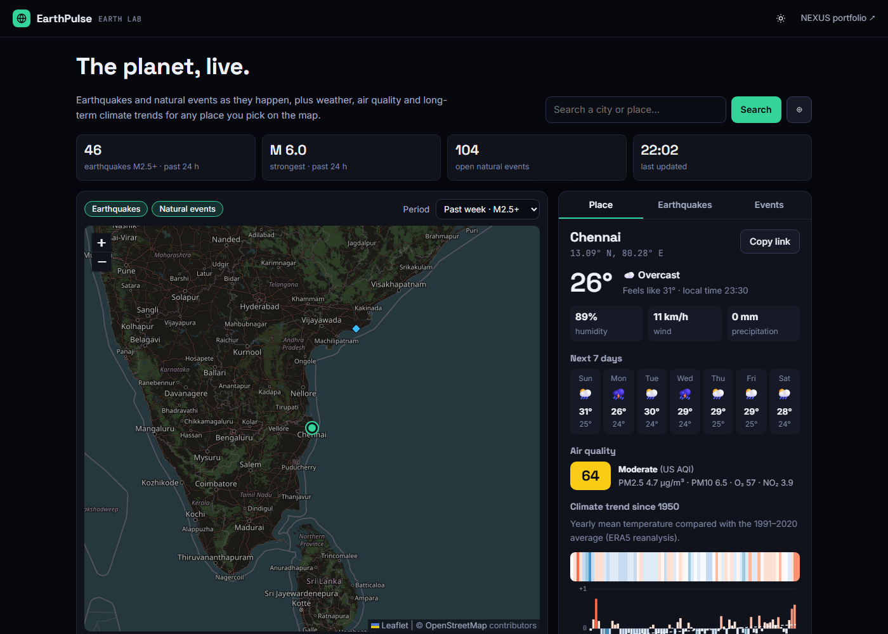

# EarthPulse

**Climate & geospatial intelligence on one live map.**

[](https://github.com/Nausheen1295/earthpulse/actions/workflows/test.yml)

🌍 **Live site:** https://nausheen1295.github.io/earthpulse/

EarthPulse brings real-time earth data together in one place. See earthquakes and natural events as they happen, then click any point on the planet to get its weather, air quality and long-term climate trend.

Part of the Earth Lab in my portfolio, [NEXUS](https://nausheen1295.github.io/portfolio/).



## Features

- **Live earthquakes:** USGS feeds for the past day, week or month.
  - Marker size shows magnitude and colour shows depth.
  - Tsunami flags are shown, and every quake links to its USGS event page.
- **Natural events:** open NASA EONET events (wildfires, severe storms, volcanoes, sea ice and more), filterable by type. Events mapped as an area are pinned at the centre of that area.
- **Any place on Earth:** click the map, search a city or use your location to see:
  - current weather and a 7-day forecast
  - air quality (US AQI, PM2.5, PM10, O₃, NO₂)
  - the climate trend since 1950
- **Climate trend:**
  - Warming stripes and a yearly anomaly chart against the 1991–2020 average, built from ERA5 reanalysis.
  - Also shows the trend in °C per decade, how the past 12 months compare, and the warmest year on record for that point.
- **Shareable links:** the selected place is kept in the URL (`?lat=…&lon=…&name=…`).
- **Auto-refresh:** feeds refresh quietly every 5 minutes, without closing an open popup.
- **Themes and devices:** dark and light themes, keyboard-friendly tabs and search, and a layout that works on phones.

## How it works

```
Browser (static site on GitHub Pages)
│
├── Leaflet map ◄── OpenStreetMap tiles
├── js/api.js ──► USGS earthquake GeoJSON feeds
│             ──► NASA EONET v3 events
│             ──► Open-Meteo forecast, air-quality, geocoding and ERA5 archive APIs
│             ──► Nominatim reverse geocoding (place names for clicked points)
├── js/climate.js   pure functions: yearly anomalies, trend, 12-month anomaly, colour scales
└── js/app.js       map layers, panels, search and URL state
```

- There is no backend and no API keys. Every data source is free, public and allows browser requests.
- The climate maths runs in the browser on about 27,000 daily values per place.
- Only complete years count, so a partial year never looks unusually warm or cold.
- Each panel fails on its own. If one source is down, the rest of the page keeps working, and a newer selection always replaces an older one that is still loading.

## Tech

HTML, CSS and JavaScript (ES modules), [Leaflet](https://leafletjs.com/) and hand-drawn SVG charts. There is no build step.

## Run locally

```bash
git clone https://github.com/Nausheen1295/earthpulse.git
cd earthpulse
npx serve .          # or: python -m http.server
npm test             # unit tests for the climate maths (Node 22+)
```

## Data sources

| Data | Source |
|---|---|
| Earthquakes | [USGS Earthquake Hazards Program](https://earthquake.usgs.gov/earthquakes/feed/) |
| Natural events | [NASA EONET](https://eonet.gsfc.nasa.gov/) |
| Weather, air quality, geocoding, ERA5 climate archive | [Open-Meteo](https://open-meteo.com/) |
| Map tiles, reverse geocoding | © [OpenStreetMap](https://www.openstreetmap.org/copyright) contributors |

## Limits

- **Grid resolution:** ERA5 is a reanalysis on a grid of about 25 km. The trend describes that grid cell, not a single weather station.
- **Air quality:** the readings are modelled values from Open-Meteo, not sensor measurements.

---

Built by **Nausheen Haleelur Rahman**. [Portfolio](https://nausheen1295.github.io/portfolio/) · [GitHub](https://github.com/Nausheen1295)
